# Knock Knock

A job search tracker you host yourself, built for doing the search with an AI assistant. Paste a pile of job links to Claude and they land as jobs with the pay, level, reports-to and must-haves filled in. Let it read your inbox and calendar, and each confirmation, scheduling email, rejection and interview invite lands on the right job's timeline, without duplicates. Then, on the call itself, your stories are one search away.

The app only stores and shows. Your assistant does the reading and the judging over MCP, so there's no AI bill inside the app and nothing scans your mail behind your back.

[](https://deploy.workers.cloudflare.com/?url=https://github.com/tyler-class/knockknock)

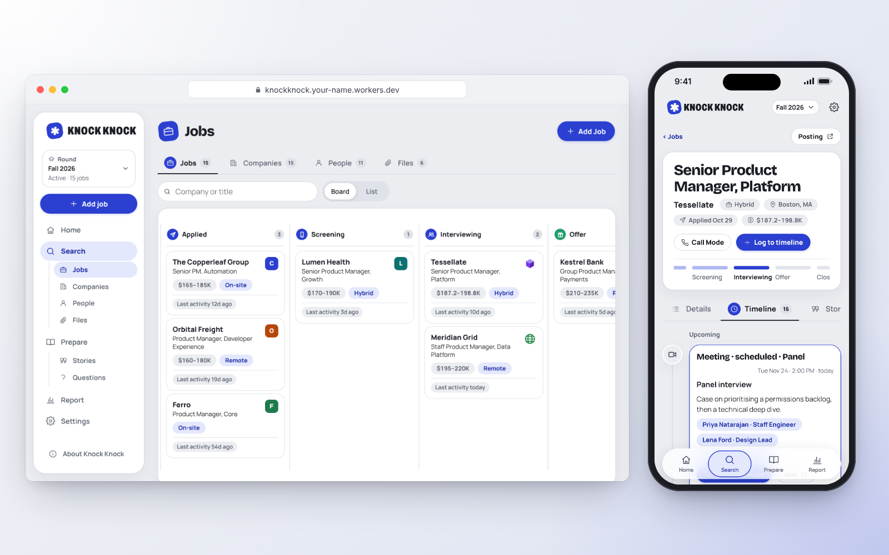

One deployment is one person's job search (or many, one after another: rounds keep each stretch separate). It runs on your own Cloudflare account, and the free plan is plenty.

## What it does

### Home

Counts for the round you're in (applications, open, applied this week, interviews this week), what's coming up in the next two weeks, and recent activity across every job. Tap an activity to jump to it on that job's timeline.

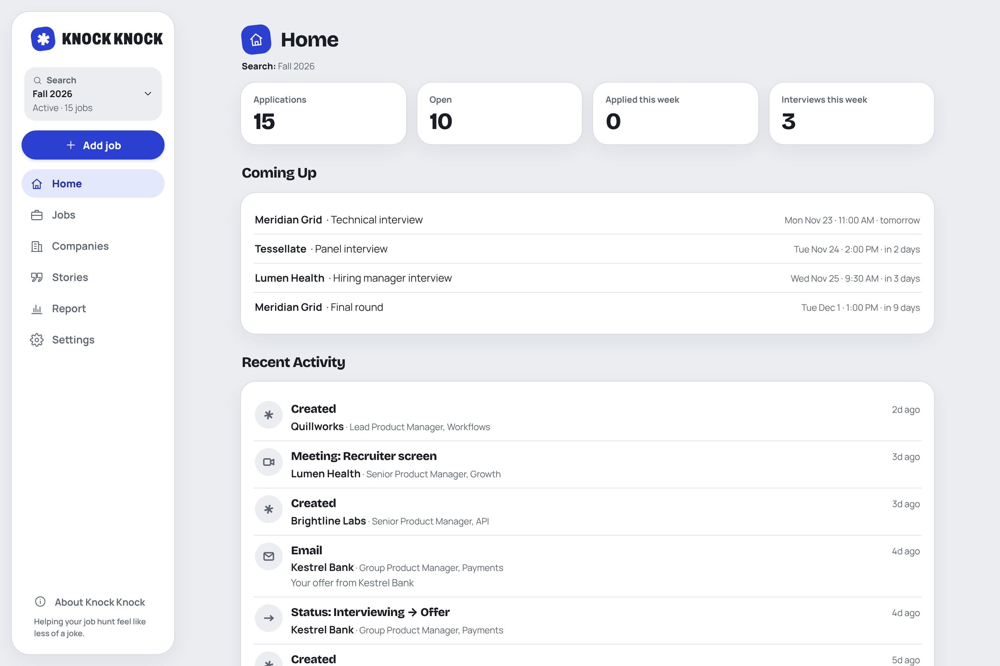

### Jobs

A board with a lane per stage on a computer, a list with stage tabs on a phone. Drag cards into your own order within a lane, or onto another lane to change the status. Each card shows the company's logo, pay, work mode and source, how long since anything happened, and a highlighted pill only when there's something to act on: an interview coming up, an offer to decide on, a job gone quiet.

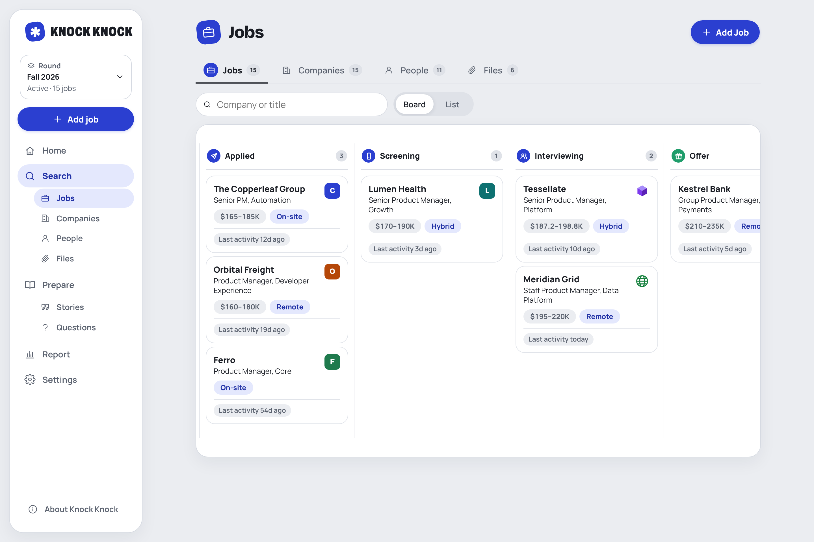

### A page for every job

A header with the title, company, work mode, location, applied date and pay, and a stage bar: Saved → Applied → Screening → Interviewing → Offer → Closed (Accepted, Rejected, Declined or Ghosted). Tap a stage to move the job there. Tabs for Details, Timeline, Stories and Files. Every detail (title, pay, links, requirements, notes, the pasted posting) edits in place where it's shown: tap it, type, and it saves when you press Enter or click away.

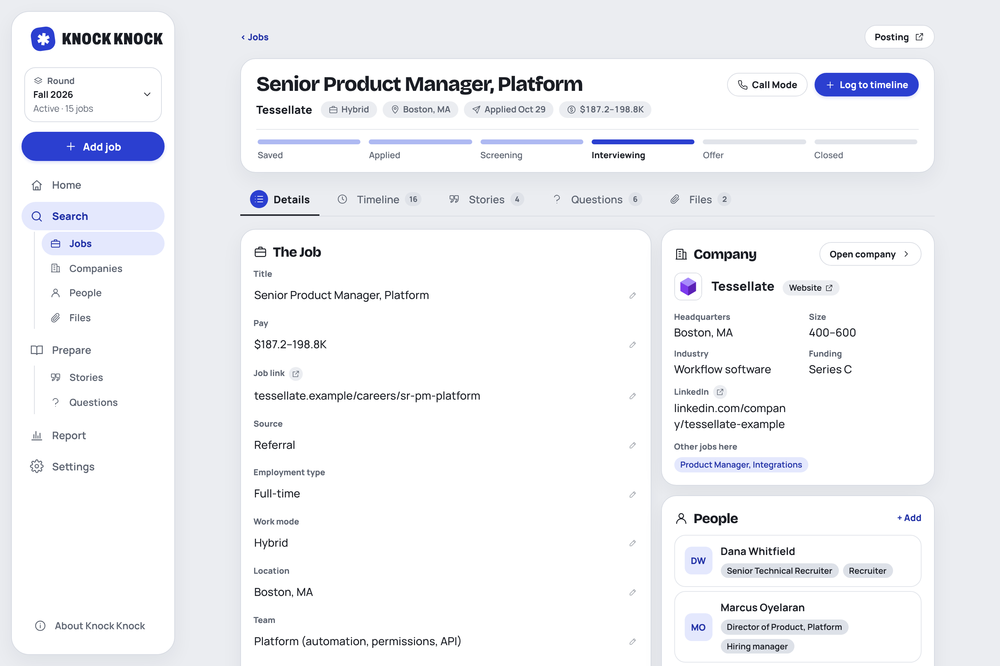

### The timeline

Every job has one: status changes, meetings (kind, time, join link, attendees, topics), emails (a summary of what happened, with key points for negotiations), notes and files. Upcoming meetings sit on top, then everything else, newest first, with notes nested under the meeting or email they're about. Tap any entry to open it and edit it in place.

**Status is history, not a field.** Every change is an event on the timeline, and the status is whatever the timeline says. Backfilling "they rejected me on the 3rd" lands in the right place, closed jobs remember the stage they closed from, and the report counts everything correctly. Changing a status can be undone from the toast.

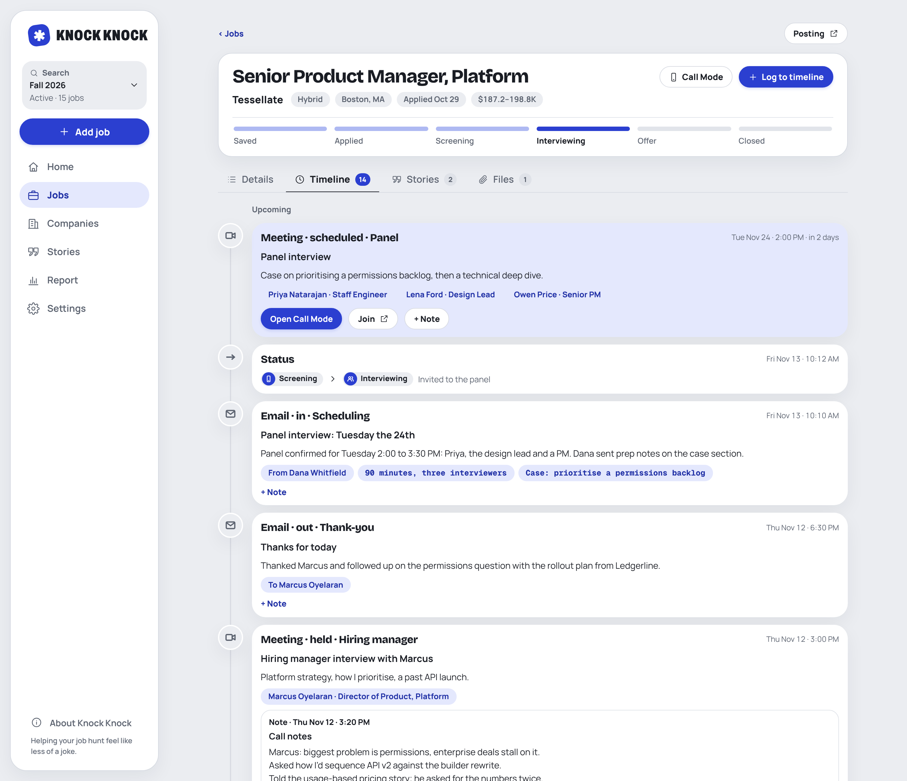

### Companies and people

A company is its own record with its website, LinkedIn, headquarters, size, industry and funding, and can have several jobs. People (recruiters, hiring managers, interviewers, referrers) work at a company and can be on any of its jobs.

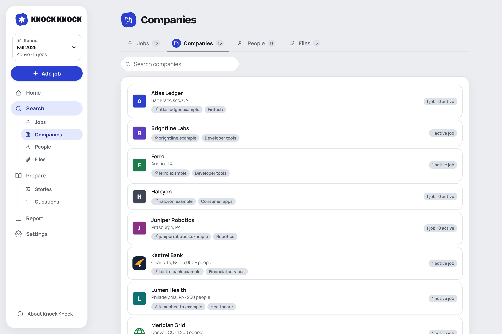

A company's page holds its details, the jobs you have there across every search, and its people. Its logo shows here, on the jobs there and in every list. A company can be deleted from its page; the popup says how many jobs and people go with it.

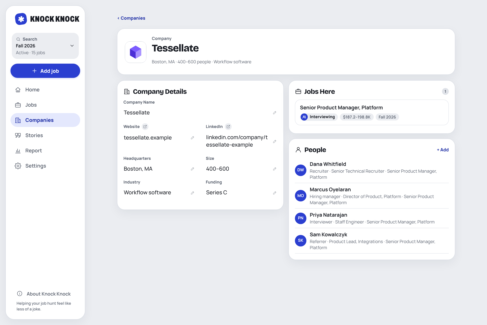

A company without a logo gets a monogram: the first letter of its name (skipping a leading "The" or "A") on an ultramarine tile. Pick another of ten colors from the ⋯ menu on its page, or upload a logo there. Your assistant can also find a company's logo on the web and attach it, and match the monogram to the brand's color.

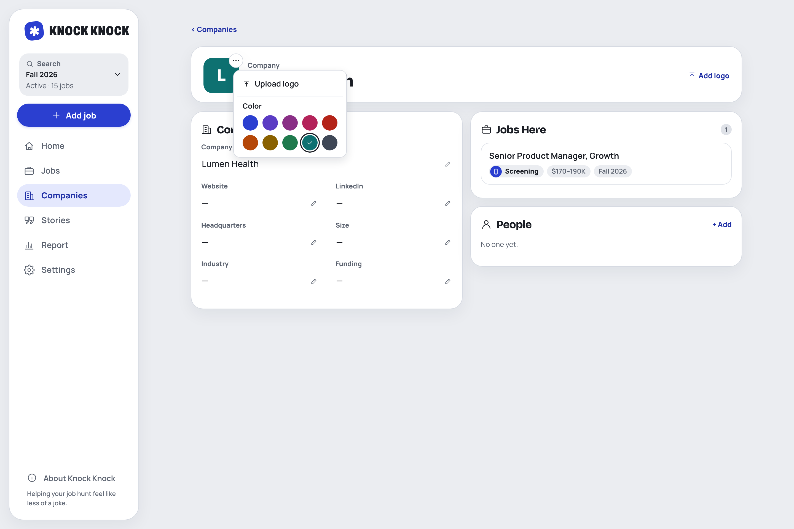

**People** and **Files** list everyone and every file across your companies and jobs, beside Companies under one set of tabs. Tap someone to edit them, take them off a job, or delete them.

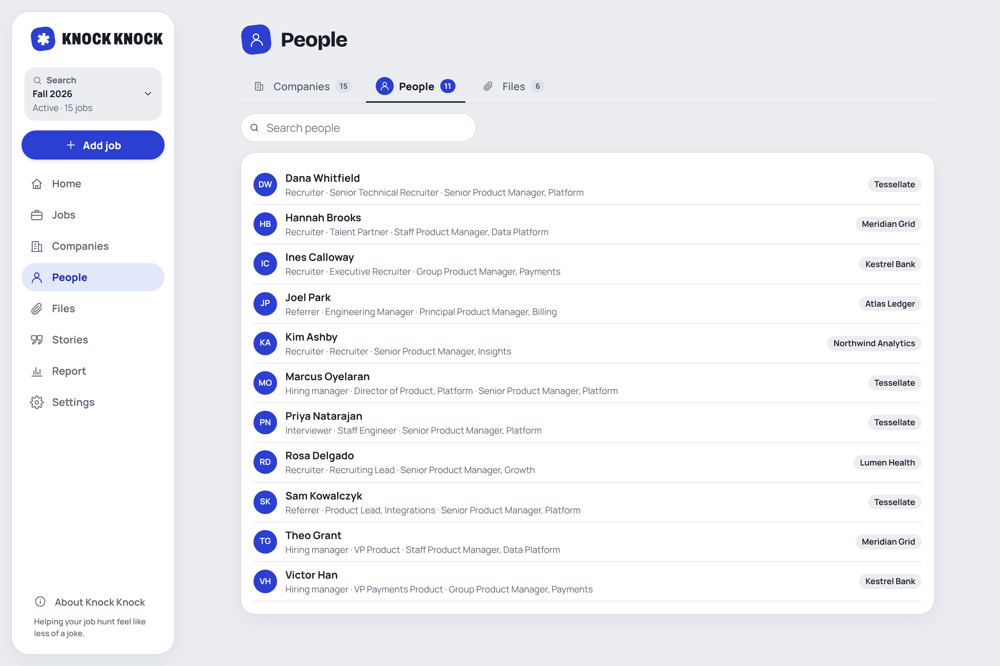

### Stories

STAR, CAR, SOAR, Introduction, Why this job, Why I'm looking, Failure, Weakness, Design decision, or a framework of your own. A story is its framework's parts. Search by the question you were asked and the stories whose words match come up first.

**A copy for each job.** Linking a story to a job copies it, so you can tailor it and add how to angle it for this company without touching the original. The copy says in plain words when you've changed it for this job or the original in Stories has changed since, and offers the one or two actions that fit.

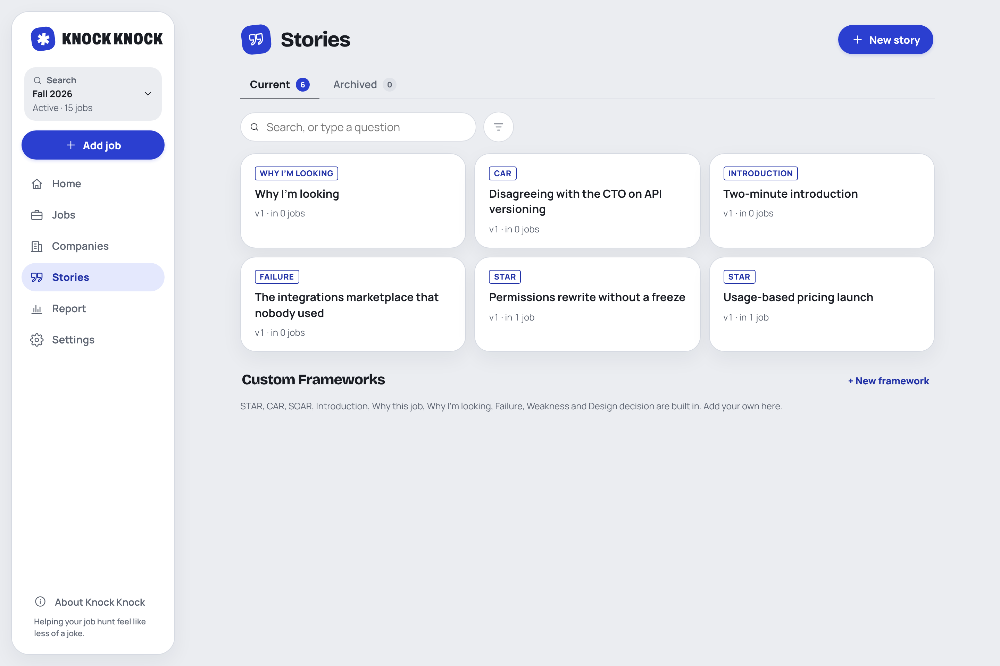

### Call Mode

A full-screen view to keep beside the video call: who's in the room, the topics, call notes that save themselves to the meeting as you type, and a search box. Type the question you just heard and the job's stories, then the rest of Stories, come up with each part in big type and the angle for this job. **End call** asks how it went and saves your reflections as their own note.


### Report

Where every application went (a Sankey built from status history), how many heard back and how many reached interviews and offers, response rate by where you found the job and by which resume you sent, median time to hear back, and how many you applied to each week.

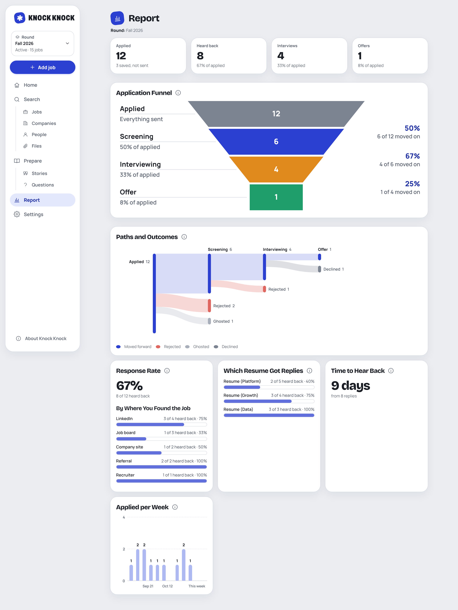

### Built for phones

Install it to your home screen and it works like an app, with notifications for interviews today, jobs that have gone quiet, and debriefs to write.

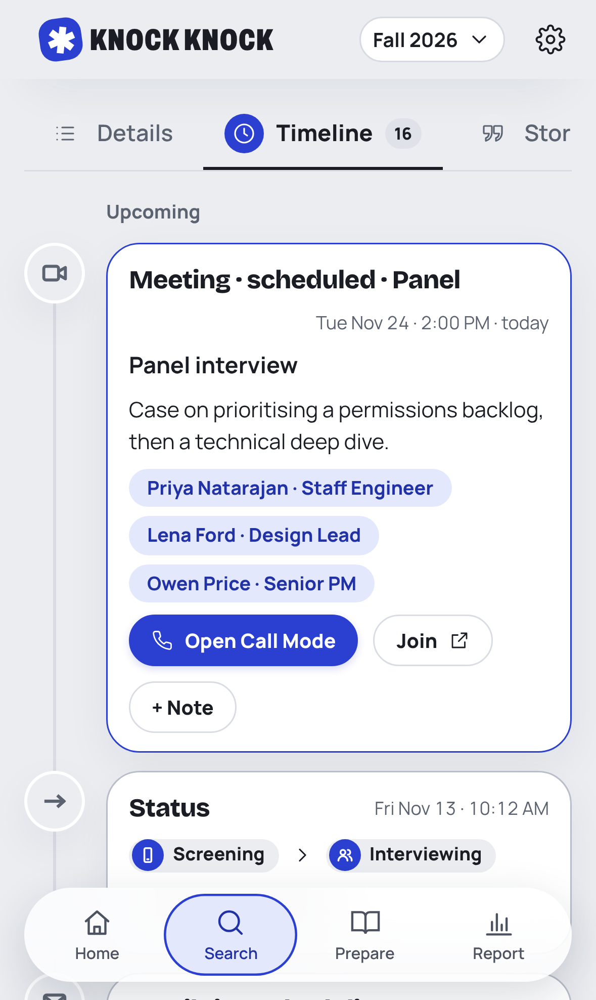

### And

- **Files.** Resumes, cover letters, transcripts and offer letters in your own private R2 bucket, with a SHA-256 of exactly what you sent. Adding one puts it on the timeline, and the Files page lists every file across your jobs. Transcripts and other text files stay readable for your assistant.
- **Rounds.** Each stretch of job hunting is its own round. Pick it from the menu at the top of the sidebar; everything but Stories and Companies follows it.
- **Yours.** It runs on your own Cloudflare account, and your data stays in your own database and storage.

<!-- kit:readme:start -->
<!-- Written by the Selfhost Kit (kit/docs/readme-install.md): edit it there. -->

## Install

You need two free accounts, and about five minutes.

### 1. Have a Cloudflare account

Knock Knock runs on your own Cloudflare account. The free plan is plenty. If you don't have one, [sign up](https://dash.cloudflare.com/sign-up) and confirm your email.

<!-- 📸 SCREENSHOT docs/screenshots/install-1-cloudflare-signup.png: Cloudflare's sign-up page -->

### 2. Have a GitHub account

The Deploy button makes your own copy of Knock Knock's code in your GitHub account, so you can keep it updated. If you don't have one, [sign up](https://github.com/signup).

### 3. Let Cloudflare use your GitHub

Cloudflare needs its **Cloudflare Workers and Pages** app installed on your GitHub account to create your copy and deploy it.

1. Open [github.com/apps/cloudflare-workers-and-pages](https://github.com/apps/cloudflare-workers-and-pages) and click **Install** (or **Configure** if it's already installed).
2. Choose your account.
3. Pick **All repositories**. That's simplest, because the Deploy button creates a new one. If you'd rather limit it, choose **Only select repositories** and come back to add your Knock Knock copy after step 4.
4. Click **Install**.

<!-- 📸 SCREENSHOT docs/screenshots/install-3-github-app.png: GitHub's install page for Cloudflare Workers and Pages, with All repositories selected -->

You can also do this in the middle of the next step: Cloudflare asks you to connect GitHub if you haven't.

### 4. Click Deploy

[](https://deploy.workers.cloudflare.com/?url=https://github.com/tyler-class/knockknock)

Sign in to Cloudflare if it asks. You land on a setup page.

<!-- 📸 SCREENSHOT docs/screenshots/install-4-deploy-page.png: Cloudflare's "Create an application" page for Knock Knock -->

### 5. Check the names (most people keep the defaults)

- **Git account**: your GitHub account.
- **Repository name**: what your copy is called on GitHub. Leave **Create private Git repository** ticked to keep it private.
- **Project name**: the Worker's name, which is also in your address: `https://knockknock.<your-subdomain>.workers.dev`.
- **Database and storage names**: what Cloudflare calls the storage it creates for you. Keep them.

### 6. Set your password

Under **Variables and secrets**, fill in **APP_PASSWORD**: the password you sign in with. Pick something long. You can change it later (see [Change your password](#change-your-password)), but set it now.

<!-- 📸 SCREENSHOT docs/screenshots/install-6-password.png: The APP_PASSWORD field on the setup page -->

### 7. Create and deploy

Click **Create and deploy**. Cloudflare copies the code to your GitHub, creates the storage and builds Knock Knock. It takes a minute or two. When the build log finishes, your address is at the end of it, and on the Worker's page under **Domains**.

<!-- 📸 SCREENSHOT docs/screenshots/install-7-build-done.png: A finished build log with the workers.dev address at the end -->

Open it, sign in with your password, and you're done. Bookmark it, or add it to your phone's home screen.

<!-- 📸 SCREENSHOT docs/screenshots/install-7-signed-in.png: Knock Knock right after signing in -->

### 8. Set up automatic updates (recommended)

Your copy checks for updates every 6 hours once you allow it. That takes one click, once:

1. In Knock Knock, open **Settings → Updates** and choose **Set up automatic updates**.
2. GitHub opens with the update file filled in. Click **Commit changes**.

That brings in the latest Knock Knock straight away, then checks again every 6 hours. See [Updates](#updates) for how it works.

<!-- 📸 SCREENSHOT docs/screenshots/install-8-updates.png: Settings → Updates with the Set up automatic updates button -->
<!-- 📸 SCREENSHOT docs/screenshots/install-8-commit.png: GitHub's new-file page with the update file filled in, and the Commit changes button -->

## Notifications

Knock Knock can send notifications to your phone. They only work in the app installed on your phone (added to your Home Screen), not in a browser tab.

**Install it on iPhone or iPad** (iOS 16.4 or later):

1. Open Knock Knock in Safari and tap **Share**.
2. Tap **Add to Home Screen**, then **Add**.
3. Open Knock Knock from the new Home Screen icon.

**Install it on Android:** open Knock Knock in Chrome, open the menu **⋮** and tap **Install app** (or **Add to Home screen**), then open it from the new icon.

**Turn them on:** in the installed app, open **Settings → Notifications** and switch on **Notifications on this device**. Allow notifications when your phone asks. Each device has its own on/off switch and choices. **Send a test** checks it's working.

## Updates

Updates take two steps, both in your own accounts. Knock Knock never deploys to your Cloudflare directly.

1. **Knock Knock → your GitHub copy.** The update workflow you added in step 8 brings in the latest code, checking every 6 hours. To update now, open **Settings → Updates → Update now** and click **Run workflow** on GitHub. Settings also tells you when a newer version is out.
2. **Your GitHub copy → your Cloudflare.** Cloudflare builds and deploys every change to your copy, migrating the database first. This was switched on in step 7.

Your data lives in your Cloudflare database and file storage, not in the code, so updates don't touch it. An update replaces the code in your copy, so changes you made to it are overwritten. Your copy's own name and storage settings are kept.

Deployed by hand instead? `git pull`, then `npm run deploy`.

## Change your password

1. In Cloudflare, open **Compute → Workers & Pages** and choose **knockknock**.
2. Open the **Settings** tab. Under **Variables and Secrets**, find **APP_PASSWORD** (type **Secret**) and click its pencil icon.
3. Type the new password and save. You can't see the current one, only set a new one.

Everyone is signed out and signs in again with the new password.

<!-- 📸 SCREENSHOT docs/screenshots/password-1-secrets.png: The Variables and Secrets list with APP_PASSWORD and its pencil icon -->

## Use your own domain (advanced)

Your address starts as `https://knockknock.<your-subdomain>.workers.dev`. Two ways to change it:

- **Rename your workers.dev subdomain.** In Cloudflare, open **Compute → Workers & Pages**. Your subdomain is shown on the right, with **Change**. It applies to every Worker in your account, so all your apps move together.
- **Give Knock Knock its own address on a domain you own**, like `knockknock.example.com`. The domain has to be on Cloudflare. Open the Worker, go to **Settings → Domains & Routes → Add → Custom domain**, and enter the address. Cloudflare sets up DNS and the certificate. Repeat for each app to give each one its own subdomain.

<!-- 📸 SCREENSHOT docs/screenshots/domain-1-custom-domain.png: Settings → Domains & Routes → Add → Custom domain -->

If you connected an AI assistant, connect it again with the new address.

## Anonymous usage counts

Once a day your copy tells Knock Knock's developer that it exists: a random id it made for itself, its version, how many rounds, applications, timeline events, stories and files it has (counts only), how many files it stores, and whether automatic updates are on. Never names, contents or anything you type, and no IP address is kept. It shows how many copies are in use. Turn it off in **Settings → Updates → Share anonymous usage counts**: your copy sends one last message saying it's off, then nothing.

<!-- kit:readme:end -->

## Connect an AI assistant

Knock Knock includes an [MCP](https://modelcontextprotocol.io) server at `https://<your-knock-knock>/mcp`. Open **Settings → Connect an AI assistant** to copy your URL and see steps for Claude, ChatGPT, Claude Code and others. When an assistant connects, Knock Knock shows a sign-in page; enter your password to approve it. **Settings → Connect an AI assistant** also lists what's connected and can sign them all out.


### How the agent flows work

The app never reads your email. Your assistant does (Claude with Gmail and Calendar connected, on a schedule if you like), decides what happened and to which application, and writes it here:

1. **Bulk intake.** Paste a dozen links. For each, the assistant checks `find_applications` by URL, reads the posting with `read_posting`, and calls `create_application` with every field it can find (it lists the ones it inferred, like reports-to). They land as **Saved** in the current round, each linked to its company (made if it's new).
2. **"Thanks for applying."** The assistant finds the application (`find_applications` by company, domain, URL or a person's email), reads `get_timeline` around that date, logs the email with its Gmail message id as `external_ref`, and calls `set_status` to **Applied** with `caused_by` pointing at the email.
3. **Interview scheduled.** An email and a calendar invite. If you already typed the meeting in, `get_timeline` shows it and the assistant uses `update_meeting` to add the join link and attendees instead of adding a second card.

**Duplicates.** The rule, written into the tools: read before you write. Same type, same people, within a few days: it's probably the same thing, so update it. The app makes one check itself: the same `external_ref` (Gmail message, calendar event) can't be logged twice on one application. Every write also answers with what's nearby on that timeline, so an assistant can spot a duplicate it just made and fix it in the same turn.

### Tools

| Tool                                            | What it does                                                                                                                                                           |
| ----------------------------------------------- | ---------------------------------------------------------------------------------------------------------------------------------------------------------------------- |
| `round_overview`                                | The current round: counts by status, open applications, upcoming meetings, follow-ups due, maybe-ghosted, debriefs due                                                 |
| `get_started`                                   | The round's state plus example requests and ready-made prompts                                                                                                         |
| `find_applications`                             | Look up by company, title, domain, posting URL or a person's email, in the current search unless `all_searches` is set                                                 |
| `get_application`                               | Everything about one: posting and company fields, people, timeline, stories, files                                                                                     |
| `get_timeline`                                  | Events, optionally only around a date and of some types: read this before logging                                                                                      |
| `read_posting`                                  | The whole posting from its link: the job board's own data (Greenhouse, Lever, Ashby, SmartRecruiters, Workday), the page's job data, or the page as a browser loads it |
| `create_application`, `update_application`      | Add a job (returns the existing one for a known posting URL); change its fields, including the company's details                                                       |
| `set_company_logo`                              | Attach a company's logo from an image on the web, set its monogram's color (closest to the brand), or remove the logo                                                  |
| `set_status`                                    | Change status by writing a status event; on Accepted, lists the other open applications                                                                                |
| `log_meeting`, `update_meeting`                 | An interview or call: time, kind, state, join link, attendees, topics                                                                                                  |
| `log_email`                                     | An email as a summary, with direction, category and key points                                                                                                         |
| `add_note`                                      | A note, optionally under a meeting (a debrief)                                                                                                                         |
| `update_event`, `delete_event`                  | Fix or remove an event (deleting a status event recomputes the status)                                                                                                 |
| `add_person`                                    | A recruiter, hiring manager, interviewer, referrer or someone else on a job, at its company                                                                            |
| `list_frameworks`, `list_stories`, `get_story`  | Story frameworks; search Stories by the question being asked                                                                                                           |
| `list_archived_stories`                         | Archived stories, which the other tools leave out, and how to bring one back                                                                                           |
| `create_story`, `update_story`                  | Add or change a story (or archive and unarchive it)                                                                                                                    |
| `link_story`, `update_job_story`                | Copy a story to a job with an angle for it; tailor the job's copy                                                                                                      |
| `upload_link`, `add_text_file`, `get_file_text` | A one-time upload link; save a transcript you have as text; read one                                                                                                   |

Ready-made prompts (in Claude, from the **+** menu):

| Prompt           | What it does                                                                                       |
| ---------------- | -------------------------------------------------------------------------------------------------- |
| `add_jobs`       | Reads each posting and creates a Saved application, skipping ones you already have                 |
| `sync_inbox`     | Reads recent email and calendar invites and writes them to the right timelines, without duplicates |
| `prep_interview` | Who's in the room, what to expect, which stories to bring                                          |
| `debrief`        | Turns your notes or a transcript into a debrief note under the meeting                             |
| `weekly_review`  | What moved, what went quiet, and one thing to change next week                                     |

## Back up and restore

**Settings → Backup → Download backup** saves everything as one JSON file: searches, companies, applications, people, timelines, stories and their job copies, custom frameworks, settings, and every file's details (and the text of text files). **Restore from backup** replaces everything with a backup's contents. The files themselves live in R2; restoring into the same deployment keeps them attached.

## Deploy by hand

```sh
git clone https://github.com/tyler-class/knockknock.git && cd knockknock
npm install
npx wrangler login
npx wrangler secret put APP_PASSWORD
npm run deploy
```

`npm run deploy` builds the app, applies migrations to the remote database, then deploys the Worker. Wrangler creates the D1 database, the R2 bucket (`knockknock-files`) and the KV namespace on the first deploy.

## Local development

```sh
npm install
cp .dev.vars.example .dev.vars    # then set APP_PASSWORD
npm run db:migrate:local
npm run dev
```

| Script                       | What it does                                              |
| ---------------------------- | --------------------------------------------------------- |
| `npm run dev`                | Vite dev server with the Worker running in workerd        |
| `npm run build` / `preview`  | Production build / serve the build locally                |
| `npm test`                   | Unit tests and Workers-runtime API and MCP tests (Vitest) |
| `npm run typecheck` / `lint` | TypeScript, ESLint and Prettier                           |
| `npm run deploy`             | Build, migrate the remote database, then deploy           |
| `npm run icons`              | Redraw the app icons from the asterisk                    |

### How it's built

- **Cloudflare Workers** with static assets. **Hono** serves the API under `/api`. **D1** stores everything; the schema is in `migrations/`:
  - `searches` group `applications` (jobs). Each job points at its company (`company_id`) and keeps a copy of the company's name and details in its own `company_*` columns, kept in step on every change, so lists, search and assistants read one row. `board_position` is its place within its lane on the Jobs board.
  - `companies` hold a company's website, LinkedIn, headquarters, size, industry, funding and logo (stored in R2), and `logo_color`, the monogram's color when there's no logo (a key from `LOGO_COLORS` in `src/shared/logo.ts`; null is ultramarine). Several jobs can be at one company; a company name written to a job links it to the company of that name, ignoring case, or makes one.
  - `people` work at a company (`company_id`), with a role (`recruiter`, `hiring_manager`, `interviewer`, `referrer` or `other`, with `other_role` in their own words). `job_people` says which of its jobs each person is on. Deleting a job leaves its people at the company.
  - `events` are the timeline: one table for created, status, meeting, email and note events. Each type's own fields are JSON checked by zod schemas in `src/shared/schemas.ts`. A partial unique index refuses a repeated `external_ref` per job.
  - `stories` and `job_stories` (each job's copies), `frameworks` (custom ones; the built-in frameworks live in code) and `files` (metadata, hash and kept text; the bytes are in R2).
- A job's `status` is a cache of its timeline: the newest created or status event (by when it happened) decides it, recomputed on every change (`src/shared/logic/status.ts`).
- Story copies remember the original's version and a content hash from when they were copied, which is enough to tell whether the copy, the original, or both have changed since (`src/shared/logic/stories.ts`). Stories are searched by title, framework name and the parts' text.
- Report numbers come from `src/shared/logic/report.ts`. "Heard back" means a job moved past Applied or was rejected; time to hear back runs from applying to the first such change.
- **R2** stores files privately under `files/<id>` and logos under `logos/<id>`, served only to signed-in users.
- **React**, **TypeScript**, **Vite**, **TanStack Query** and **React Router**, with a service worker from `vite-plugin-pwa`. Call Mode's search runs in the browser: instant, and it works offline.
- AI assistants connect over MCP with OAuth 2.1 (`@cloudflare/workers-oauth-provider`). MCP tools call the same API as the app, so validation and the duplicate rule are shared.

## Why "Knock Knock"?

Because getting a job is a f✱cking joke sometimes.

## Support

Knock Knock is free and built by [Tyler Class](https://tylerclass.net). Questions or help: [knockknock@tylerclass.net](mailto:knockknock@tylerclass.net)

## License

[MIT](LICENSE)
