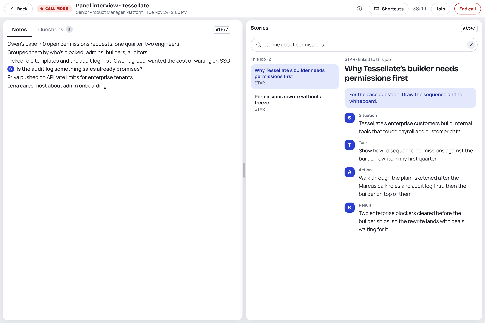
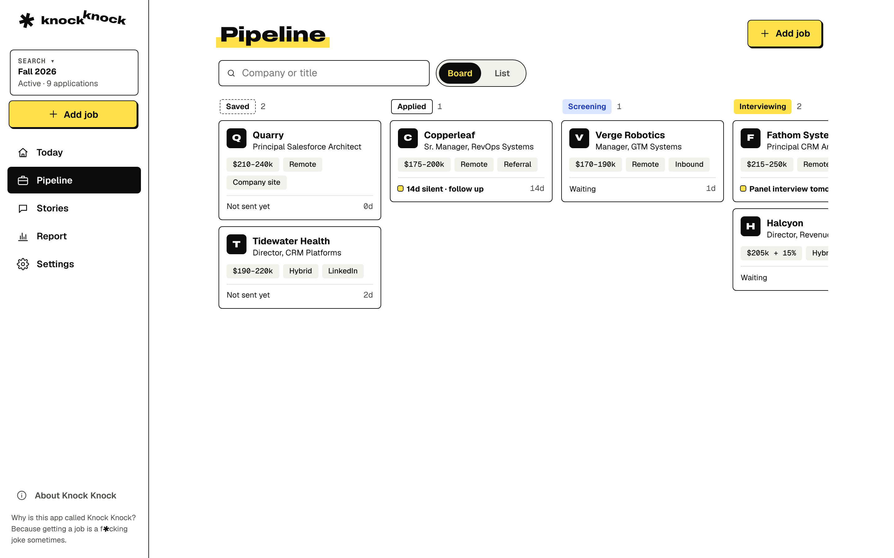
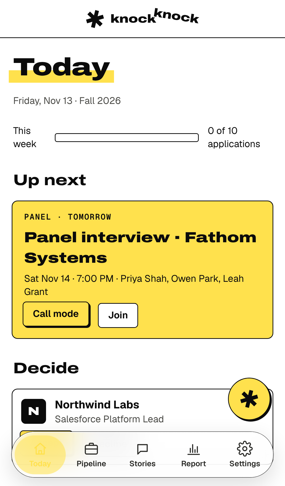

# Knock Knock

A job search tracker you host yourself, built for doing the search with an AI assistant. Paste a pile of job links to Claude and they land as applications with the pay, level, reports-to and must-haves filled in. Let it read your inbox and calendar, and each confirmation, scheduling email, rejection and interview invite lands on the right application's timeline, without duplicates. Then, on the call itself, your stories are one search away.

The app only stores and shows. Your assistant does the reading and the judging over MCP, so there's no AI bill inside the app and nothing scans your mail behind your back.

[](https://deploy.workers.cloudflare.com/?url=https://github.com/tyler-class/knockknock)


- **Every application is a timeline.** Created, status changes, meetings (with join link, attendees and topics), emails (a summary of what happened, with key points for negotiations) and notes, newest first, with upcoming interviews above the NOW line and debriefs nested under their meeting. Each card says whether you or your assistant logged it.
- **Status is history, not a field.** Saved → Applied → Screening → Interviewing → Offer → Accepted, or Rejected, Declined or Ghosted, recording the stage it closed from. Every change is an event, so backfilling "they rejected me on the 3rd" lands in the right place and the report counts everything correctly.
- **A story bank with real frameworks.** STAR, CAR, SOAR, Introduction, Why this job, Why I'm looking, Failure, Weakness, Design decision, or your own. Each story lists the interview questions it answers.
- **Copies per job.** Linking a story to an application copies it. Tailor the copy and add an angle for this job; the bank only changes if you push. The copy shows when it's in sync, edited, or behind the bank, and you can push, pull or save it as a new story.
- **Call mode.** A full-screen view to keep beside the video call. Type the question you just heard, and the stories whose probable questions match come up first, with S/T/A/R (or P/P/F) in big type and the angle for this job. Call notes save themselves to the job's timeline as you type (on the meeting) and stay on screen; **End call** asks how it went and saves your reflections as their own note.
- **Today.** Interviews coming up, offers to decide on, meetings that still need a debrief, applications gone quiet, and ones that look ghosted (only ever suggested).
- **Report.** A Sankey of where every application went, built from status history, plus response rate, interview rate, median days to first reply and ghost rate, broken down by source and by the resume you sent.
- **Files.** Resumes, cover letters, transcripts and offer letters in your own private R2 bucket, with a hash of exactly what you sent and a lock so it can't be deleted by accident. Transcripts stay readable for your assistant.
- **Built for phones.** Install it to your home screen. Notifications for interviews today, follow-ups and debriefs.
- **Yours.** It runs on your own Cloudflare account. The free plan is plenty.



One deployment is one person's job search (or many, one after another: searches keep each stretch separate).

## Screenshots






<!-- kit:readme:start -->
<!-- Written by the Selfhost Kit (kit/docs/readme-install.md): edit it there. -->

## Install

You need two free accounts, and about five minutes.

### 1. Have a Cloudflare account

Knock Knock runs on your own Cloudflare account. The free plan is plenty. If you don't have one, [sign up](https://dash.cloudflare.com/sign-up) and confirm your email.

<!-- 📸 SCREENSHOT docs/screenshots/install-1-cloudflare-signup.png: Cloudflare's sign-up page -->

### 2. Have a GitHub account

The Deploy button makes your own copy of Knock Knock's code in your GitHub account, so you can keep it updated. If you don't have one, [sign up](https://github.com/signup).

### 3. Let Cloudflare use your GitHub

Cloudflare needs its **Cloudflare Workers and Pages** app installed on your GitHub account to create your copy and deploy it.

1. Open [github.com/apps/cloudflare-workers-and-pages](https://github.com/apps/cloudflare-workers-and-pages) and click **Install** (or **Configure** if it's already installed).
2. Choose your account.
3. Pick **All repositories**. That's simplest, because the Deploy button creates a new one. If you'd rather limit it, choose **Only select repositories** and come back to add your Knock Knock copy after step 4.
4. Click **Install**.

<!-- 📸 SCREENSHOT docs/screenshots/install-3-github-app.png: GitHub's install page for Cloudflare Workers and Pages, with All repositories selected -->

You can also do this in the middle of the next step: Cloudflare asks you to connect GitHub if you haven't.

### 4. Click Deploy

[](https://deploy.workers.cloudflare.com/?url=https://github.com/tyler-class/knockknock)

Sign in to Cloudflare if it asks. You land on a setup page.

<!-- 📸 SCREENSHOT docs/screenshots/install-4-deploy-page.png: Cloudflare's "Create an application" page for Knock Knock -->

### 5. Check the names (most people keep the defaults)

- **Git account**: your GitHub account.
- **Repository name**: what your copy is called on GitHub. Leave **Create private Git repository** ticked to keep it private.
- **Project name**: the Worker's name, which is also in your address: `https://knockknock.<your-subdomain>.workers.dev`.
- **Database and storage names**: what Cloudflare calls the storage it creates for you. Keep them.

### 6. Set your password

Under **Variables and secrets**, fill in **APP_PASSWORD**: the password you sign in with. Pick something long. You can change it later (see [Change your password](#change-your-password)), but set it now.

<!-- 📸 SCREENSHOT docs/screenshots/install-6-password.png: The APP_PASSWORD field on the setup page -->

### 7. Create and deploy

Click **Create and deploy**. Cloudflare copies the code to your GitHub, creates the storage and builds Knock Knock. It takes a minute or two. When the build log finishes, your address is at the end of it, and on the Worker's page under **Domains**.

<!-- 📸 SCREENSHOT docs/screenshots/install-7-build-done.png: A finished build log with the workers.dev address at the end -->

Open it, sign in with your password, and you're done. Bookmark it, or add it to your phone's home screen.

### 8. Set up automatic updates (recommended)

Your copy updates itself every Monday once you allow it. That takes one click, once:

1. In Knock Knock, open **Settings → Updates** and choose **Set up automatic updates**.
2. GitHub opens with the update file filled in. Click **Commit changes**.

That brings in the latest Knock Knock straight away, then every week. See [Updates](#updates) for how it works.

<!-- 📸 SCREENSHOT docs/screenshots/install-8-commit.png: GitHub's new-file page with the update file filled in, and the Commit changes button -->

## Notifications

Knock Knock can send notifications to your phone. They only work in the app installed on your phone (added to your Home Screen), not in a browser tab.

**Install it on iPhone or iPad** (iOS 16.4 or later):

1. Open Knock Knock in Safari and tap **Share**.
2. Tap **Add to Home Screen**, then **Add**.
3. Open Knock Knock from the new Home Screen icon.

**Install it on Android:** open Knock Knock in Chrome, open the menu **⋮** and tap **Install app** (or **Add to Home screen**), then open it from the new icon.

**Turn them on:** in the installed app, open **Settings → Notifications** and switch on **Notifications on this device**. Allow notifications when your phone asks. Each phone chooses its own, so each device picks what it gets. **Send a test** checks it's working.

## Updates

Updates take two steps, both in your own accounts. Knock Knock never deploys to your Cloudflare directly.

1. **Knock Knock → your GitHub copy.** The update workflow you added in step 8 brings in the latest code every Monday. To update now, open **Settings → Updates → Update now** and click **Run workflow** on GitHub. Settings also tells you when a newer version is out.
2. **Your GitHub copy → your Cloudflare.** Cloudflare builds and deploys every change to your copy, migrating the database first. This was switched on in step 7.

Your data lives in your Cloudflare database and file storage, not in the code, so updates don't touch it. An update replaces the code in your copy, so changes you made to it are overwritten. Your copy's own name and storage settings are kept.

Deployed by hand instead? `git pull`, then `npm run deploy`.

## Change your password

1. In Cloudflare, open **Compute → Workers & Pages** and choose **knockknock**.
2. Open the **Settings** tab. Under **Variables and Secrets**, find **APP_PASSWORD** (type **Secret**) and click its pencil icon.
3. Type the new password and save. You can't see the current one, only set a new one.

Everyone is signed out and signs in again with the new password.

<!-- 📸 SCREENSHOT docs/screenshots/password-1-secrets.png: The Variables and Secrets list with APP_PASSWORD and its pencil icon -->

## Use your own domain (advanced)

Your address starts as `https://knockknock.<your-subdomain>.workers.dev`. Two ways to change it:

- **Rename your workers.dev subdomain.** In Cloudflare, open **Compute → Workers & Pages**. Your subdomain is shown on the right, with **Change**. It applies to every Worker in your account, so all your apps move together.
- **Give Knock Knock its own address on a domain you own**, like `jobs.example.com`. The domain has to be on Cloudflare. Open the Worker, go to **Settings → Domains & Routes → Add → Custom domain**, and enter the address. Cloudflare sets up DNS and the certificate. Repeat for each app to give each one its own subdomain.

<!-- 📸 SCREENSHOT docs/screenshots/domain-1-custom-domain.png: Settings → Domains & Routes → Add → Custom domain -->

If you connected an AI assistant, connect it again with the new address.

## Anonymous usage counts

Once a day your copy tells Knock Knock's developer that it exists: a random id it made for itself, its version, how many searches, applications, timeline events, stories and files it has (counts only), how many files it stores, and whether automatic updates are on. Never names, contents or anything you type, and no IP address is kept. It shows how many copies are in use. Turn it off in **Settings → Updates → Share anonymous usage counts**: your copy sends one last message saying it's off, then nothing.

<!-- kit:readme:end -->

## Connect an AI assistant

Knock Knock includes an [MCP](https://modelcontextprotocol.io) server at `https://<your-knock-knock>/mcp`. Open **Settings → Connect an AI assistant** to copy your URL and see steps for Claude, ChatGPT, Claude Code and others. When an assistant connects, Knock Knock shows a sign-in page; enter your password to approve it. Everything it writes shows **via** its name on the timeline.

### How the agent flows work

The app never reads your email. Your assistant does (Claude with Gmail and Calendar connected, on a schedule if you like), decides what happened and to which application, and writes it here:

1. **Bulk intake.** Paste a dozen links. For each, the assistant checks `find_applications` by URL, reads the posting, and calls `create_application` with every field it can find (it lists the ones it inferred, like reports-to). They land as **Saved**.
2. **"Thanks for applying."** The assistant finds the application (`find_applications` by company, domain, URL or a person's email), reads `get_timeline` around that date, logs the email with its Gmail message id as `external_ref`, and calls `set_status` to **Applied** with `caused_by` pointing at the email.
3. **Interview scheduled.** An email and a calendar invite. If you already typed the meeting in, `get_timeline` shows it and the assistant uses `update_meeting` to add the join link and attendees instead of adding a second card.

**Duplicates.** The rule, written into the tools: read before you write. Same type, same people, within a few days: it's probably the same thing, so update it. The app makes one check itself: the same `external_ref` (Gmail message, calendar event) can't be logged twice on one application. Every write also answers with what's nearby on that timeline, so an assistant can spot a duplicate it just made and fix it in the same turn.

### Tools

| Tool                                            | What it does                                                                                                        |
| ----------------------------------------------- | ------------------------------------------------------------------------------------------------------------------- |
| `search_overview`                               | The current search: counts by status, open applications, upcoming meetings, follow-ups, maybe-ghosted, debriefs due |
| `get_started`                                   | The search's state plus example requests and ready-made prompts                                                     |
| `find_applications`                             | Look up by company, title, domain, posting URL or a person's email                                                  |
| `get_application`                               | Everything about one: fields, people, timeline, stories and their sync state, files                                 |
| `get_timeline`                                  | Events, optionally only around a date and of some types: read this before logging                                   |
| `create_application`, `update_application`      | Add a job (returns the existing one for a known URL); change its fields                                             |
| `set_status`                                    | Change status by writing a status event; on Accepted, lists the other open applications                             |
| `log_meeting`, `update_meeting`                 | An interview or call: time, kind, state, join link, attendees, topics                                               |
| `log_email`                                     | An email as a summary, with direction, category and key points                                                      |
| `add_note`                                      | An internal note, optionally under a meeting (a debrief)                                                            |
| `update_event`, `delete_event`                  | Fix or remove an event (deleting a status event recomputes the status)                                              |
| `add_person`                                    | A recruiter, interviewer or referrer on an application                                                              |
| `list_frameworks`, `list_stories`, `get_story`  | Story frameworks; search the bank by the question being asked                                                       |
| `create_story`, `update_story`                  | Add or change a bank story                                                                                          |
| `link_story`, `update_job_story`                | Copy a story to an application, tailor the copy                                                                     |
| `upload_link`, `add_text_file`, `get_file_text` | A one-time upload link; save a transcript you have as text; read one                                                |

Ready-made prompts (in Claude, from the **+** menu):

| Prompt           | What it does                                                                                       |
| ---------------- | -------------------------------------------------------------------------------------------------- |
| `add_jobs`       | Reads each posting and creates a Saved application, skipping ones you already have                 |
| `sync_inbox`     | Reads recent email and calendar invites and writes them to the right timelines, without duplicates |
| `prep_interview` | Who's in the room, what to expect, which stories to bring                                          |
| `debrief`        | Turns your notes or a transcript into a debrief note under the meeting                             |
| `weekly_review`  | What moved, what went quiet, and one thing to change next week                                     |

## Back up and restore

**Settings → Backup → Download backup** saves every search, application, timeline, story and file record as one JSON file. **Restore from backup** replaces everything with a backup's contents. The files themselves live in R2; restoring into the same deployment keeps them attached.

## Deploy by hand

```sh
git clone https://github.com/tyler-class/knockknock.git && cd knockknock
npm install
npx wrangler login
npx wrangler secret put APP_PASSWORD
npm run deploy
```

`npm run deploy` builds the app, applies migrations to the remote database, then deploys the Worker. Wrangler creates the D1 database, the R2 bucket (`knockknock-files`) and the KV namespace on the first deploy.

## Local development

```sh
npm install
cp .dev.vars.example .dev.vars    # then set APP_PASSWORD
npm run db:migrate:local
npm run dev
```

| Script                       | What it does                                              |
| ---------------------------- | --------------------------------------------------------- |
| `npm run dev`                | Vite dev server with the Worker running in workerd        |
| `npm run build` / `preview`  | Production build / serve the build locally                |
| `npm test`                   | Unit tests and Workers-runtime API and MCP tests (Vitest) |
| `npm run typecheck` / `lint` | TypeScript, ESLint and Prettier                           |
| `npm run deploy`             | Build, migrate the remote database, then deploy           |
| `npm run icons`              | Redraw the app icons from the asterisk                    |

### How it's built

- **Cloudflare Workers** with static assets. **Hono** serves the API under `/api`. **D1** stores searches, applications, people, timeline events, frameworks, stories, job copies and file metadata; the schema is in `migrations/`.
- An application's `status` is a cache of its timeline: the newest created or status event (by when it happened) decides it, recomputed on every change (`src/shared/logic/status.ts`).
- Timeline events share one table; each type's own fields (meeting, email, status) are JSON checked by zod schemas in `src/shared/schemas.ts`. A partial unique index refuses a repeated `external_ref` per application.
- Story copies remember the bank version and a content hash from when they were copied, which is enough to tell in sync, edited, bank newer or both (`src/shared/logic/stories.ts`). Built-in frameworks live in code; custom ones in D1.
- **R2** stores files privately under `files/<id>`, served only to signed-in users; text files keep their text for MCP.
- **React**, **TypeScript**, **Vite**, **TanStack Query** and **React Router**, with a service worker from `vite-plugin-pwa`. Call mode's search is plain word overlap in the browser: instant, and it works offline.
- AI assistants connect over MCP with OAuth 2.1 (`@cloudflare/workers-oauth-provider`). MCP tools call the same API as the app, so validation and the duplicate rule are shared.

## Why "Knock Knock"?

Because getting a job is a f✱cking joke sometimes.

## Support

Knock Knock is free and built by [Tyler Class](https://tylerclass.net). Questions or help: [knockknock@tylerclass.net](mailto:knockknock@tylerclass.net)

## License

[MIT](LICENSE)
